&nbsp;
&nbsp;

<!-- streak -->

<!-- /streak -->

I build backend systems where correctness matters: payment ledgers, real-time engines, and the infrastructure that makes AI tools reliable.

**Currently building:** **[Mochee](https://mochee-app.vercel.app/)**, a 3D tutor and study platform where students practice their own material against each other and compete in ranked duels for College Board exams like the SAT/PSAT, with the scope still growing; and [FastRust](https://github.com/Purabhh/FastRust), a FastAPI-style web framework

**Looking to collaborate on:** AI tooling & infrastructure

### [Mochee](https://mochee-app.vercel.app/) · TypeScript, Node.js, PostgreSQL, Redis, WebSockets
Backend for a multi-user SAT/PSAT prep platform. Real-time 1v1 duel engine where the server owns the clock and scoring, scaled across instances with Redis pub/sub, with Elo updates in row-locked Postgres transactions, an event-sourced match log, and exactly-once payouts via idempotency keys. Every generated question is verified by an independent re-solve before publishing. **100+ backend tests.**

### [FastRust](https://github.com/Purabhh/FastRust) · Rust, Tokio, Hyper, Serde, rustls
A FastAPI-style web framework built from scratch: trie router, typed extractors, route macros, and middleware, with OpenAPI 3.1 docs and Swagger UI generated from route metadata. Benchmarked at **under 2.3 µs** per request.

### [vaultdb](https://github.com/Purabhh/vaultdb) · Python, Ollama, SQLite, MCP
Local-first knowledge base and MCP server: parses an Obsidian vault into code-aware chunks, embeds them with Ollama, and serves hybrid keyword + vector search to Claude Code through 4 MCP tools. Kept live with a file watcher. **98 tests.**

### [LeaseLink](https://github.com/Purabhh/LeaseLink) · TypeScript, React, Express, PostgreSQL
**1st place, MusaLabs Hackathon** (50+ teams). Full-stack housing-matching app with Google OAuth and real-time WebSocket chat.

### [Gambit](https://gambit-amber.vercel.app) · JavaScript, three.js, Stockfish, MediaPipe · [repo](https://github.com/Purabhh/gambit)
**Just fully revamped.** Hands-free 3D chess against Stockfish: point at a piece with your webcam to see its legal moves, say where it goes, and confirm with "yes". The revamp added pinch-and-drag moves, thumbs up/down and open-palm gestures, animated capture fights between toon pieces, a game log with clocks and takebacks, voice menus on every screen, and a new app icon.

**Software Engineering Intern @ BNY** · Jun – Aug 2026
Payments platform: blockchain audit trail for $2B+ in cleared payments, real-time SWIFT message tracing across 15M+ daily messages (Java, Spring Boot, Angular)

**Software Engineering Intern @ Essex Securities** · May – Aug 2025
LangChain/RAG agent for earnings-report analysis, BTC-USD spot exchange with a matching engine and double-entry ledger, Bloomberg EMSX integration

**Software Engineering Intern @ Azonix Tech** · May – Aug 2024
Real-time facial recognition at the edge, IoT telemetry pipeline, predictive-maintenance ML model

**Rutgers University, New Brunswick**
B.S. Computer Science, Minor in Data Science · Aug 2023 – May 2027 · Dean's List

